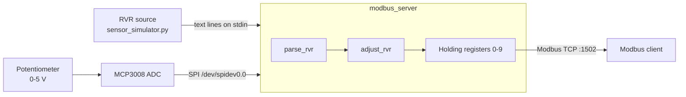
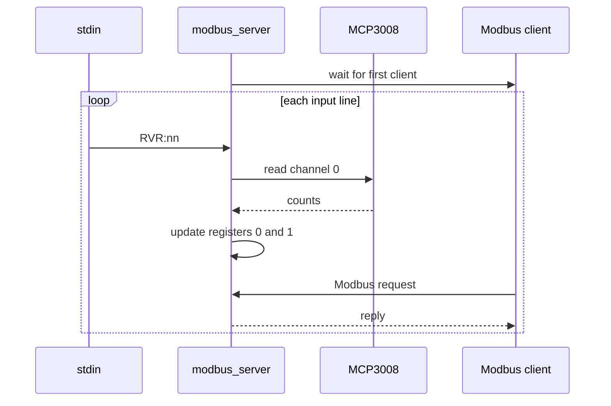

# Interface Control Document: rvr-modbus

| Field | Value |
|-------|-------|
| Document | ICD-RVR-001 |
| Version | 0.2 (draft, as implemented) |
| Platform | Raspberry Pi 3B+, Raspberry Pi OS 32-bit |

## 1. Purpose and scope
Defines the interfaces of the RVR Visibility Modbus Service: what it reads, how it processes the data, what it publishes over Modbus TCP, and how it behaves on bad input. It does not describe internal module design.

## 2. System context



## 3. Interface summary

| ID | Interface | Direction | Medium |
|----|-----------|-----------|--------|
| IF-1 | RVR input | In | Text lines on standard input |
| IF-2 | Light intensity | In | MCP3008 ADC over SPI |
| IF-3 | RVR output | Out | Modbus TCP, port 1502 |

## 4. IF-1: RVR input

One ASCII line per report:

```
RVR:<value>
```

| Element | Definition |
|---------|------------|
| Prefix | Literal `RVR:` (case-sensitive) |
| `<value>` | Decimal number in units of 100 ft. `RVR:12` means 1200 ft |
| Terminator | LF or CRLF |
| Maximum length | 127 characters per line |
| Transport | Standard input only. A physical serial source must be redirected into stdin by the caller |

Lines that do not start with `RVR:`, and negative values, are rejected (see section 9). The sender sets the report rate; the service processes one line at a time as it arrives.

## 5. IF-2: Light intensity input

| Parameter | Value |
|-----------|-------|
| Sensor | Potentiometer, 0 to 5 V, simulating runway light intensity |
| Converter | MCP3008, 10-bit, single-ended |
| Bus | Linux spidev `/dev/spidev0.0`, SPI mode 0, 8 bits per word, 1.35 MHz |
| Channel | 0 |
| Scaling | `intensity = counts / 1023`, giving 0.0 to 1.0 |
| Sampling | Once per accepted RVR line |

## 6. Processing

```
raw_ft   = value * 100
adjusted = raw_ft * (1 + 0.25 * intensity)
register = (int) adjusted        // truncated, stored as 16-bit unsigned
```

- The adjustment factor ranges from 1.00 (intensity 0) to 1.25 (intensity 1).
- The coefficient 0.25 is provisional, pending calibration against real runway lighting data.
- A 16-bit register holds 0 to 65535. Inputs above about 52 400 ft would wrap; the service does not enforce a maximum.

## 7. IF-3: Modbus TCP output

### 7.1 Connection

| Parameter | Value |
|-----------|-------|
| Role | Modbus TCP server (libmodbus) |
| Bind address | `0.0.0.0` |
| Port | 1502 |
| Clients | One. A single connection is accepted at startup |
| Unit ID | Not checked; any unit ID is answered |
| Authentication | None |

### 7.2 Register map

Ten holding registers, addresses 0 to 9. Coils, discrete inputs and input registers are not allocated.

| Address | Name | Encoding |
|---------|------|----------|
| 0 | Adjusted RVR | Feet, 16-bit unsigned, updated on every accepted input line |
| 1 | Low-visibility flag | 1 if raw RVR is below 1200 ft (RVR12), else 0 |
| 2 to 9 | Unused | Always 0 |

Registers initialise to 0, so before the first input line a client reads 0 in both registers. Function 0x03 (read holding registers) is the intended access. Requests to unallocated tables or to addresses outside 0 to 9 return an illegal data address exception.

## 8. Polling behaviour

The service is single-threaded. Each accepted input line triggers this sequence:



| Item | Behaviour |
|------|-----------|
| Startup | The service waits for a client to connect before it reads any input |
| Request handling | After each update the service serves one request, then reads the next line |
| Blocking | If no request arrives, the loop waits for one |
| Client rate | A client should poll once per input line. Faster polling gets replies delayed to the input rate |
| Freshness | A reply always holds the values from the most recent accepted line |
| Staleness | There is no timestamp or heartbeat register |

## 9. Error handling

| Condition | Behaviour |
|-----------|-----------|
| Line without `RVR:` prefix, or negative value | `Invalid input` printed; line discarded; registers keep last values |
| Non-numeric text after the prefix | Parsed as 0 and accepted |
| SPI device cannot be opened | Error printed; service continues |
| SPI read fails | Error printed; intensity 0.5 is used; clients are not notified |
| Context or register allocation fails | Error printed; exit status 1 |
| Port 1502 unavailable | `Failed to listen` printed; exit status 1 |
| Client disconnects | The request is skipped; the service does not accept a new connection until restarted |
| End of input | Resources released; exit status 0 |
| Process crash | systemd restarts the service |

## 10. Deployment interfaces

| Method | Interface |
|--------|-----------|
| Build | `make`, requires `libmodbus-dev` |
| systemd | `systemd/rvr-modbus.service` starts on boot and restarts on failure |
| Docker | `docker run --rm -i -p 1502:1502 rvr-modbus`; `-i` keeps stdin open. SPI is unavailable unless `/dev/spidev0.0` is passed to the container |
| k3s | Manifest in `k3s/`; the image is imported with `docker save rvr-modbus \| sudo k3s ctr images import -` |

## 11. Change history

| Version | Description |
|---------|-------------|
| 0.1 | Interfaces, input format, register map |
| 0.2 | Context diagram, processing, polling behaviour, error handling, deployment |